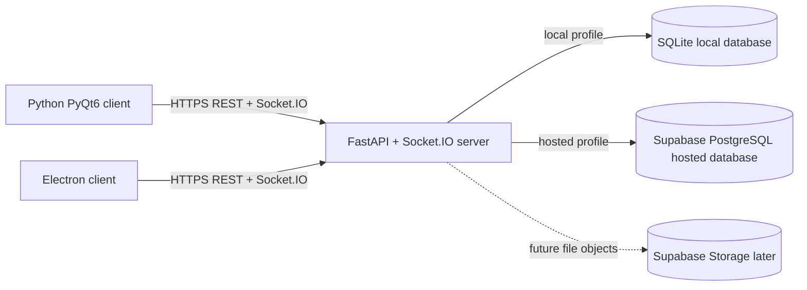

# QuantumBytes Chat - Phase 1 Architecture

Status: Architecture baseline; implementation and local packaging are complete through Phase 8 preparation.

This document defines the architecture and client/server contract for the
WhatsApp-style desktop chat application. Implementation decisions and later
phase details are tracked in `DECISIONS.md`, `PROTOCOL.md`, and `PROGRESS.md`.

## 1. Goal and Scope

The application has one shared Python server and two different desktop
clients:

- Client A: Python + PyQt6, built first.
- Client B: Electron + JavaScript, built after Client A works.

Both clients use the same HTTP API and Socket.IO event protocol. A user on the
Python client can therefore chat with a user on the Electron client without
the server knowing which GUI they use.

Version 1 is built in these increments:

1. Real-time text messages for direct chats and rooms.
2. Username/password accounts, password hashing, JWT login, and history.
3. Typing indicators, online status, timestamps, delivery status, and limited
   image/file sharing.

Email verification, password reset, end-to-end encryption, voice/video calls,
push notifications, and multi-server scaling are deliberately outside v1.

## 2. Recommended Technology Choices

### Server

- Python 3.12+.
- FastAPI for REST endpoints, validation, health checks, and startup.
- `python-socketio` in ASGI mode for real-time events.
- Pydantic models for request and event validation.
- SQLAlchemy 2 plus Alembic for database access and migrations.
- SQLite locally; PostgreSQL for the hosted deployment.
- `pwdlib` with Argon2id for password hashing.
- `PyJWT` for short-lived access tokens.
- `slowapi` or a small server-side limiter for basic rate limiting.

The application code should use SQLAlchemy so that changing from SQLite to
PostgreSQL is a configuration change rather than a rewrite.

### Python desktop client

Use **PyQt6**.

PyQt6 is the better fit for this particular GUI because it provides mature
layouts, scroll areas, model/view widgets, signals, keyboard focus handling,
dialogs, and styling. Those features map naturally to a contact list, a
scrolling message list, chat bubbles, and settings screens.

The basic GUI mental model is:

- A `QMainWindow` is the application shell.
- Layouts decide where widgets go and resize them.
- Widgets display or collect information.
- Signals are events such as button clicks or text changes.
- Slots are functions that respond to those events.
- The GUI thread must only update widgets. Network work runs in a worker
  thread and sends results back through Qt signals.

This avoids freezing the window when a server is slow or a message arrives.

### Electron desktop client

- Electron main process owns the application window and lifecycle.
- Preload exposes a small, explicit API with `contextBridge`.
- Renderer contains the chat UI and has no direct Node.js access.
- `socket.io-client` handles real-time communication.
- `contextIsolation: true` and `nodeIntegration: false` are mandatory.

The Electron mental model is similar but split across processes: the main
process is trusted desktop code, preload is the narrow bridge, and the
renderer is the user interface.

### Database and hosted deployment

Local development uses SQLite because it is zero-configuration and easy to
inspect. It is appropriate for one local server process and learning.

For an online server, use **Supabase Free PostgreSQL** as the first hosted
database. The server remains the owner of authentication and business logic;
clients do not connect directly to Supabase.

Trade-offs:

- SQLite: simple, local, fast for development, but not suitable for multiple
  hosted instances and a Render free service loses its local files.
- Supabase PostgreSQL: persistent and reachable from Render, but introduces a
  hosted connection string, network latency, migrations, and free-tier
  inactivity limits.

For files, v1 can initially store small files through the server using a
strict size limit. A later production version should use object storage such
as Supabase Storage rather than storing binary data in the database.

### Temporary free host: Render

Render Free is recommended for the learning deployment because it can run a
Python ASGI web service and provides HTTPS, which is important for a public
Socket.IO connection.

The limits checked on 2026-10-27 are:

- Free web services use `0.1 CPU` and `512 MB RAM`.
- The service spins down after 15 minutes without inbound traffic, including
  WebSocket traffic.
- Waking a sleeping service takes about one minute.
- Each workspace receives 750 free instance-hours per calendar month.
- The filesystem is ephemeral. SQLite data and uploaded files are lost after
  restarts, redeploys, or sleep/wake cycles.
- Only one free instance is available, so this is not a scaling setup.
- Render can restart the service at any time and free services are not for
  production use.

The clients will show `Connecting...` during initial connection and cold
starts. Socket.IO automatic reconnection will retry with backoff. The server
will expose `/health` so a client or browser can distinguish a waking server
from an invalid URL.

Supabase Free limits checked on 2026-10-27 include 500 MB database size, 5 GB
egress, 1 GB file storage, 50,000 monthly active users, and two active free
projects. A free project pauses after one week of inactivity. These limits are
adequate for learning but not a promise of production availability. Pricing
and limits should be rechecked immediately before Phase 8 deployment.

## 3. System Architecture



The server is the authority for users, rooms, messages, timestamps, and
presence. A client may optimistically show a local pending message, but it
must treat the server acknowledgement as the source of truth.

### Message lifecycle

1. The user submits text in either client.
2. The client sends `message:send` with a client-generated `client_message_id`.
3. The server validates the JWT, room membership, size, and rate limit.
4. The server saves the message and assigns a server `message_id`.
5. The server sends `message:created` to room members.
6. The sender matches `client_message_id` and changes the pending bubble to
   sent/delivered.
7. On login or room open, the client calls the history endpoint to fill any
   missed messages.

The client ID makes retries safe: the server must not create duplicate
messages when the same send is retried after a network interruption.

## 4. Proposed Folder Structure

This is the implemented project structure, with later-phase modules added as
the application grew.

```text
quantumbytestask/
|-- docs/
|   |-- ARCHITECTURE.md
|   |-- PROTOCOL.md                 # extracted/maintained event contract
|-- server/
|   |-- app/
|   |   |-- main.py                 # FastAPI and Socket.IO startup
|   |   |-- config.py               # environment settings
|   |   |-- db.py                   # SQLAlchemy engine/session
|   |   |-- models.py               # users, rooms, memberships, messages
|   |   |-- schemas.py              # Pydantic REST/event payloads
|   |   |-- auth.py                 # Argon2id and JWT helpers
|   |   |-- routes.py               # REST endpoints
|   |   |-- socket_events.py        # Socket.IO handlers
|   |   |-- services/
|   |       |-- chat_service.py
|   |       |-- presence_service.py
|   |       |-- file_service.py
|   |-- tests/
|   |-- requirements.txt
|   |-- .env.example
|-- clients/
|   |-- pyqt/
|   |   |-- app.py
|   |   |-- config.py
|   |   |-- network_client.py
|   |   |-- models/
|   |   |-- views/
|   |   |-- widgets/
|   |   |-- tests/
|   |-- electron/
|       |-- package.json
|       |-- src/
|           |-- main.js
|           |-- preload.js
|           |-- renderer/
|               |-- index.html
|               |-- app.js
|               |-- styles.css
|-- .gitignore
|-- README.md
```

The protocol is documented separately in Phase 2 so both implementations can
refer to the same contract without importing Python code into Electron.

## 5. Event Protocol Contract

### Transport

- REST base URL: `${SERVER_URL}/api/v1`.
- Socket.IO endpoint: `${SERVER_URL}` using the Socket.IO protocol.
- Local example: `http://127.0.0.1:8000`.
- LAN example: `http://192.168.1.20:8000`.
- Hosted example: `https://quantumbytes-chat.onrender.com`.
- The client stores `SERVER_URL` in a settings/configuration layer; it is not
  hard-coded into UI code.
- Hosted clients must use HTTPS/WSS. Local HTTP is acceptable for development.

Every Socket.IO payload is a JSON object with this common shape:

```json
{
  "protocol_version": 1,
  "request_id": "optional-client-request-id",
  "data": {}
}
```

The `request_id` is useful for matching errors and acknowledgements. Server
events add an `occurred_at` ISO-8601 UTC timestamp when applicable.

### REST endpoints

| Method | Path | Purpose |
|---|---|---|
| GET | `/health` | Liveness check during cold start |
| POST | `/api/v1/auth/register` | Create username/password account |
| POST | `/api/v1/auth/login` | Return JWT access token |
| GET | `/api/v1/users/search?q=...` | Search usernames after login |
| GET | `/api/v1/rooms` | List rooms and direct conversations |
| POST | `/api/v1/rooms` | Create a group/room |
| GET | `/api/v1/rooms/{room_id}/messages` | Load paginated history |
| POST | `/api/v1/files` | Upload a limited-size file |

REST errors use this shape:

```json
{
  "error": {
    "code": "VALIDATION_ERROR",
    "message": "Message text is required",
    "field": "text",
    "request_id": "request-123"
  }
}
```

Passwords are sent only over HTTPS in hosted mode and are never logged or
stored in plain text. JWTs are sent in the REST `Authorization: Bearer ...`
header and in the Socket.IO `auth` connection option.

### Client-to-server Socket.IO events

| Event | v1 increment | Purpose |
|---|---:|---|
| `session:authenticate` | 1 | Authenticate an already-open socket if needed |
| `room:join` | 1 | Subscribe to a room |
| `room:leave` | 1 | Unsubscribe from a room |
| `message:send` | 1 | Send text or a file reference |
| `typing:set` | 3 | Announce typing state |
| `presence:refresh` | 3 | Refresh online status |
| `message:read` | 3 | Mark a message as read |

Example `message:send`:

```json
{
  "protocol_version": 1,
  "request_id": "req-901",
  "data": {
    "room_id": "room-42",
    "client_message_id": "client-8f3c",
    "kind": "text",
    "text": "Hello from PyQt6",
    "file_id": null
  }
}
```

Rules:

- `kind` is `text` in the basic phase and can later be `file` or `image`.
- Text is trimmed and limited by the server, for example 4,000 characters.
- A message must contain text for `text` or a valid `file_id` for `file` and
  `image`.
- The server checks room membership and ignores any client-supplied sender ID.
- `client_message_id` is required and unique per sender for retry safety.

### Server-to-client Socket.IO events

| Event | v1 increment | Purpose |
|---|---:|---|
| `connection:state` | 1 | Server-side connection/authentication state |
| `room:joined` | 1 | Confirm room subscription |
| `message:created` | 1 | Broadcast a saved message |
| `message:ack` | 1 | Confirm save or report rejection |
| `history:available` | 2 | Optional notification that history is ready |
| `typing:changed` | 3 | Broadcast typing state |
| `presence:changed` | 3 | Broadcast online/offline state |
| `message:status` | 3 | Broadcast sent/delivered/read state |
| `server:error` | 1 | Structured event-level error |

Example `message:created`:

```json
{
  "protocol_version": 1,
  "occurred_at": "2026-10-27T15:04:05Z",
  "data": {
    "message_id": "msg-1001",
    "client_message_id": "client-8f3c",
    "room_id": "room-42",
    "sender": {
      "user_id": "user-7",
      "username": "alice"
    },
    "kind": "text",
    "text": "Hello from PyQt6",
    "file": null,
    "status": "sent"
  }
}
```

Example `server:error`:

```json
{
  "protocol_version": 1,
  "request_id": "req-901",
  "data": {
    "code": "RATE_LIMITED",
    "message": "Too many messages. Try again shortly.",
    "retry_after_seconds": 5
  }
}
```

Unknown event fields should be ignored by clients. Unknown event names should
be logged and ignored rather than crashing the application. This allows the
protocol to grow without breaking older clients.

## 6. Connection and Reconnect Behavior

Both clients use the same visible states:

- `Connecting...`: initial connection or Render cold start.
- `Connected`: socket is open and authenticated.
- `Reconnecting (attempt N)...`: the network dropped; messages are queued
  locally only if they have a client ID and have not been acknowledged.
- `Offline`: retries are exhausted or the server URL is invalid.

Reconnect policy:

1. Retry automatically with exponential backoff and jitter, capped at 30
   seconds.
2. Keep the JWT in the client session, not in source code.
3. On reconnect, authenticate again and rejoin active rooms.
4. Request message history from the last known message timestamp/ID.
5. Retry pending messages using the same `client_message_id`.
6. Never create a second GUI/network loop to handle a reconnect.

PyQt6 implementation rule: the Socket.IO client runs in a worker thread (or
an asyncio loop owned by a worker thread). It emits Qt signals such as
`message_received` and `connection_state_changed`; only the main Qt thread
touches widgets.

Electron implementation rule: the renderer listens to a small preload API.
The renderer never imports Node modules or opens raw sockets. The socket
connection can live in the renderer through the preload boundary, or in the
main process with IPC; the chosen implementation must preserve the same
event names and security settings.

## 7. Security and Quality Baseline

- Validate all REST bodies and Socket.IO payloads with Pydantic.
- Hash passwords with Argon2id and never log passwords or JWTs.
- Keep JWT secret and database URLs in environment variables.
- Commit only `.env.example`, never `.env`.
- Add username, login, message, and upload rate limits.
- Enforce maximum text, filename, file size, and upload count limits.
- Sanitize displayed filenames and treat uploaded content as untrusted.
- Restrict CORS to configured client origins in hosted mode.
- Use HTTPS/WSS online.
- Use parameterized ORM queries; do not build SQL with string concatenation.
- Use server-generated timestamps and IDs.
- Add tests for authentication, authorization, duplicate retry, invalid room
  access, rate limiting, and reconnect/history recovery.

## 8. Phase Roadmap and Approval Gates

### Phase 2 - local server

Implement the server, event contract, SQLite models needed for basic rooms and
messages, and a small Python Socket.IO test script. Gate: two script clients
can exchange messages through one local server.

### Phase 3 - PyQt6 basic chat

Build the contact/room list, chat header, scrollable bubble list, composer,
server URL setting, connection status, and reconnect behavior. Gate: two
PyQt6 windows exchange text without either window freezing.

### Phase 4 - accounts and history

Add registration, login, Argon2id, JWT, user search, persistent rooms, and
paginated history. Gate: restart the client and see saved messages.

### Phase 4b - group rooms

Add owned groups, membership management, ownership transfer, closed empty
groups, and membership-scoped history cursors.

### Phase 5 - rich features

Add typing, presence, timestamps, delivery/read ticks, and limited file/image
sharing. Gate: invalid and oversized files are rejected safely.

### Phase 6 - Electron client

Build the main/preload/renderer structure and reproduce the protocol-driven
features. Gate: Electron can independently log in and chat with the server.

### Phase 7 - cross-client test

Run one Python user and one Electron user against the same local or LAN
server. Gate: direct chat, group chat, history, reconnect, and file limits
work across client types.

### Phase 8 - deployment and packaging

Deploy the server to Render, use Supabase PostgreSQL, recheck free-tier
limits, configure hosted URLs, build the PyInstaller executable, and package
Electron with electron-builder. Gate: both packaged clients recover from a
Render cold start and connect using configuration rather than rebuilt code.

Phase 8 checklist also includes restricting Socket.IO CORS to configured
client origins instead of `*`, and verifying `DEV_MODE=false` in Render
environment settings. `DEV_MODE` is false by default in the server.

## 9. Phase 1 Learnings

### What I learned

The GUI is only one part of the system: both desktop apps are clients, while
the server owns authentication, rooms, message validation, persistence, and
broadcasting. The event protocol is the shared language that lets two very
different GUIs interoperate.

PyQt6 uses a GUI thread plus signals and worker-thread network code. Electron
uses separate desktop and renderer processes with a preload security boundary.

### Python GUI versus Electron preview

This comparison becomes meaningful from Phase 6 onward. The initial
expectation is that PyQt6 will use less project scaffolding and feel natural
for Python logic, while Electron will require more JavaScript/process setup
but offer easier web-style visual design and a larger frontend ecosystem.

### Common mistakes and debugging

- Connecting both clients directly to SQLite instead of making the server the
  authority.
- Updating PyQt6 widgets from a network thread.
- Blocking the Electron renderer with synchronous work.
- Hard-coding `localhost`, which points to each user's own computer.
- Treating a Render cold start as a permanent connection failure.
- Saving passwords, JWT secrets, or database URLs in Git.

When debugging, first check `/health`, then the configured server URL, then
the connection status, then server logs, and finally the event payload. Log
event names and request IDs, but redact tokens and passwords.

### Small exercise

Draw the message lifecycle on paper for a user on the Python client sending a
message to a user on Electron. Include the client message ID, server message
ID, database save, broadcast, acknowledgement, and what happens if the
network drops immediately after sending.

## 10. Current Project State

Phases 1 through 7 are implemented and covered by tests. Phase 8 code and
packaging preparation are complete. Deployment activation still requires
Legend's Render and Supabase accounts; exact actions are listed in the root
README's “Steps for Legend”. Protocol changes are recorded in
`PROTOCOL.md` without renaming existing Socket.IO events.
